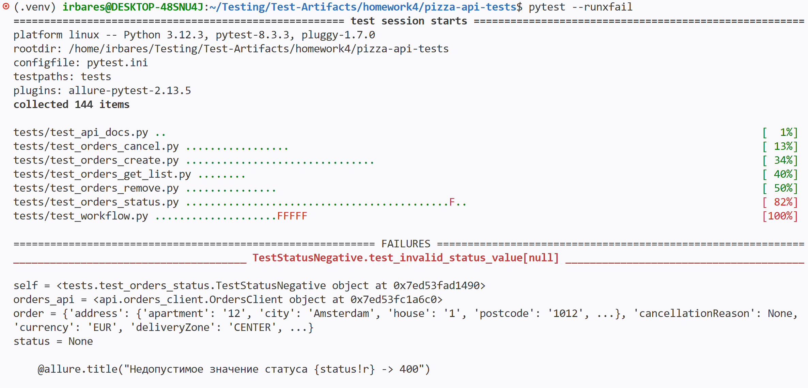
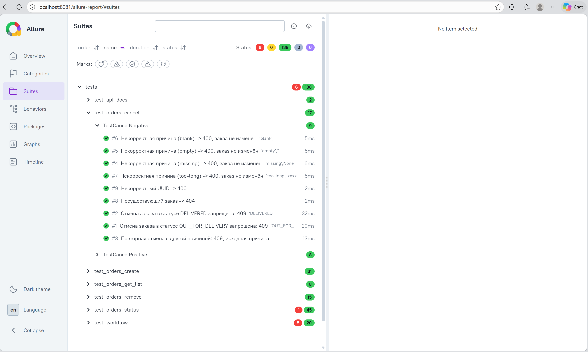
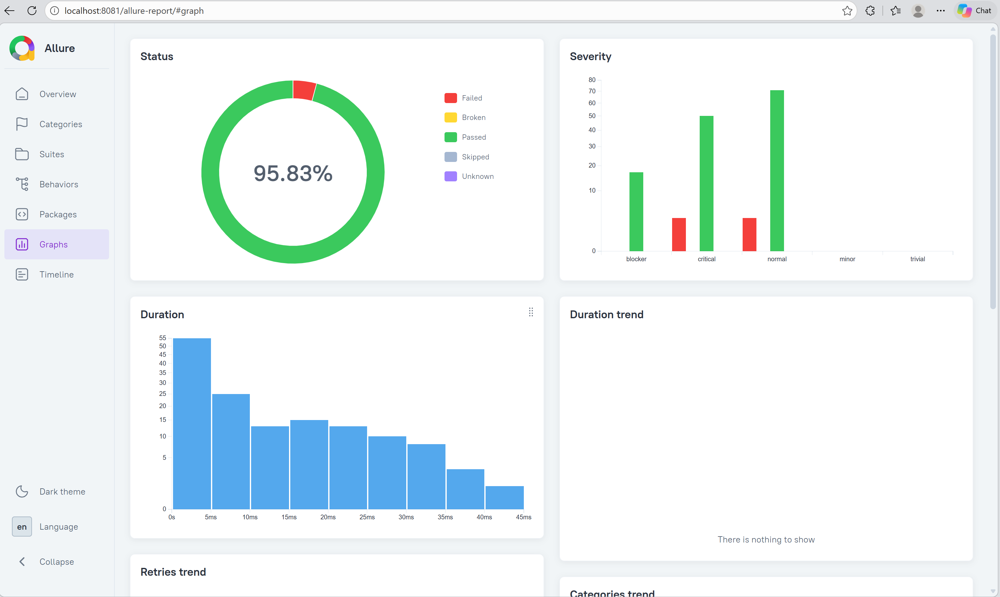

# Pizza Delivery — автотесты API

Автотесты для REST API учебного приложения
[NZRV-88/TestProject](https://github.com/NZRV-88/TestProject) (Spring Boot + PostgreSQL).

**Стек:** Python 3.10+, pytest, requests, jsonschema, allure-pytest.

## Что покрыто

| Модуль | Эндпоинты | Примеры проверок |
|---|---|---|
| `test_orders_create.py` | `POST /orders` | 201, заголовок `Location`, схема ответа, расчёт цены (SMALL/MEDIUM/LARGE, несколько позиций), зона доставки по индексу, 16 негативных payload'ов → 400 |
| `test_orders_get_list.py` | `GET /orders`, `GET /orders/{id}` | 200 + схема, 404 для неизвестного id, 400 для невалидного UUID, заказ виден в списке |
| `test_orders_status.py` | `PATCH /orders/{id}/status` | все 7 допустимых переходов → 200, все 29 запрещённых → 409, невалидный статус → 400, 404 |
| `test_orders_cancel.py` | `DELETE /orders/{id}?reason=` | 204 для CREATED/PAID/COOKING, 409 для OUT_FOR_DELIVERY/DELIVERED, идемпотентность, границы длины причины (1 и 1000), 400/404 |
| `test_orders_remove.py` | `DELETE /orders/{id}/remove?reason=` | 204 + затем 404, 409 для запрещённых статусов, повторное удаление → 404, 400 |
| `test_workflow.py` | `/seminar/workflow/orders/**` | цепочка команд, событие/policy/read model, флаги board, 404/400/409 |
| `test_api_docs.py` | `/v3/api-docs`, `/swagger-ui` | smoke: приложение поднято, документация доступна |

Во всех негативных тестах проверяется не только статус-код, но и **формат ошибки**
(`timestamp`, `status`, `error`, `message`, `path`) и, где это важно, текст сообщения.

## Структура проекта

```
pizza-api-tests/
├── config/settings.py        # BASE_URL, таймаут (из переменных окружения)
├── api/
│   ├── base_client.py        # HTTP-клиент + вложения запросов/ответов в Allure
│   ├── orders_client.py      # методы /orders
│   ├── workflow_client.py    # методы /seminar/workflow/orders
│   └── assertions.py         # assert_status / assert_schema / assert_error
├── data/order_factory.py     # фабрики payload'ов, цены, таблица переходов статусов
├── schemas/order_schemas.py  # JSON-схемы ответов
├── tests/
│   ├── conftest.py           
│   └── test_*.py             # тесты
├── docs/                     # скриншот Allure-отчёта
├── pytest.ini
└── requirements.txt
```

## Как запустить

### 1. Поднять приложение

Требуется Docker. Из корня репозитория `TestProject`:

```bash
git clone https://github.com/NZRV-88/TestProject
cd TestProject
docker compose up --build
```

### 2. Установить зависимости тестов

```bash
cd pizza-api-tests
python -m venv .venv
source .venv/bin/activate        # Windows: .venv\Scripts\activate
pip install -r requirements.txt
```

### 3. Запустить тесты

```bash
pytest --runxfail                # все тесты
pytest -m smoke                  # только smoke
pytest -m negative               # только негативные
pytest tests/test_orders_status.py -k "COOKING" # отдельные тесты
```


Результаты Allure пишутся в `allure-results/`

### 4. Открыть Allure-отчёт

```bash
allure serve allure-results                    # сформировать и открыть в браузере
# или сохранить статический отчёт:
allure generate allure-results -o allure-report --clean
allure open allure-report
```




В отчёте тесты сгруппированы по `Epic → Feature → Story`, у каждого теста есть шаги и
вложения `Request` / `Response`.
