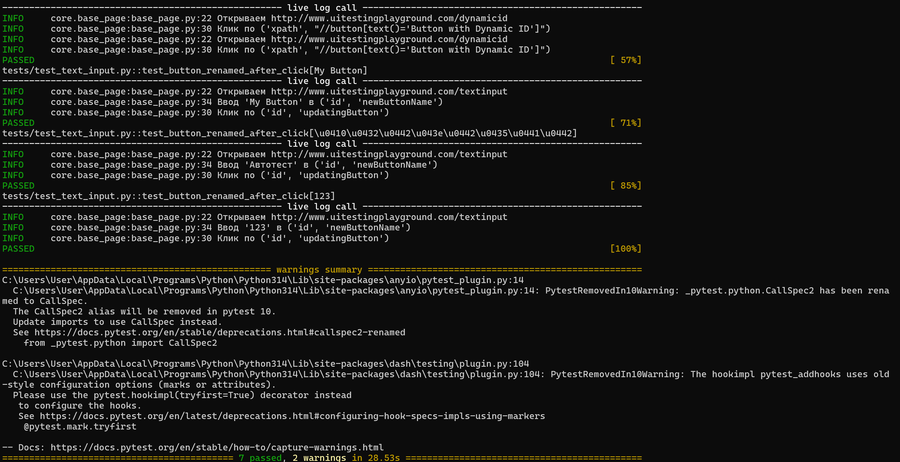

# UI-автотесты для UI Test Automation Playground

Тестируемый сайт: http://www.uitestingplayground.com/home

**Стек:** Python 3.10+, Selenium 4, pytest.

---

## Структура проекта

```
ui_autotests/
├── config/
│   └── settings.py            # Singleton: конфигурация
├── core/
│   ├── base_page.py           # Базовый Page Object: ожидания и общие действия
│   └── driver_factory.py      # Factory: создание WebDriver
├── pages/
│   ├── dynamic_id_page.py     # Страница Dynamic ID
│   ├── class_attribute_page.py# Страница Class Attribute
│   └── text_input_page.py     # Страница Text Input
├── tests/
│   ├── conftest.py            # Фикстуры pytest
│   ├── test_dynamic_id.py
│   ├── test_class_attribute.py
│   └── test_text_input.py
├── pytest.ini
├── requirements.txt
└── README.md
```

---

## Автоматизированные задачи

| № | Задача на сайте | Что проверяется |
|---|-----------------|-----------------|
| 1 | **Dynamic ID** (`/dynamicid`) | Кнопка находится и нажимается, хотя её `id` меняется при каждой загрузке. Тест открывает страницу дважды и проверяет, что `id` разные. Локатор строится по тексту кнопки. |
| 2 | **Class Attribute** (`/classattr`) | Синяя кнопка находится по точному классу `btn-primary` (а не по подстроке), клик вызывает alert с текстом «Primary button pressed». Тест запускается 3 раза, так как порядок классов на странице меняется. |
| 3 | **Text Input** (`/textinput`) | В поле вводится название, после клика кнопка переименовывается. Проверяются значения: `My Button`, `Автотест`, `123`. |

Всего 7 тестовых прогонов (1 + 3 + 3).

---

## Применённые паттерны проектирования

### 1. Page Object
**Где:** `pages/*.py`, `core/base_page.py`.
Каждая страница сайта описана отдельным классом с локаторами и действиями. Тесты не работают с Selenium напрямую, а вызывают методы страниц (`set_button_name()`, `click_primary_button()`). При изменении вёрстки правится только класс страницы, тесты остаются прежними. Общие действия (`find`, `click`, `type_text`, `get_text`, `accept_alert`) вынесены в базовый класс `BasePage`, от которого наследуются все страницы.

### 2. Factory (простая фабрика)
**Где:** `core/driver_factory.py`, метод `DriverFactory.create(browser, headless)`.
По имени браузера (`chrome`, `firefox`, `edge`) создаётся нужный WebDriver. Тесты не знают деталей создания драйвера, а новый браузер добавляется одной записью в словарь `_builders`.

### 3. Singleton
**Где:** `config/settings.py`, класс `Settings`.
Единственный экземпляр конфигурации на весь запуск: базовый URL, браузер, режим headless, таймаут ожиданий. Значения можно переопределить переменными окружения.

### 4. Fluent Interface
**Где:** методы классов страниц.
Методы возвращают `self`, поэтому действия записываются цепочкой:
```python
text_input_page.open().set_button_name("My Button").click_button()
```

### 5. Внедрение зависимостей (фикстуры pytest)
**Где:** `tests/conftest.py`.
Фикстуры создают драйвер и объекты страниц и передают их в тесты. Драйвер закрывается автоматически после каждого теста (`yield` + `quit()`).

---

## Установка и запуск

```bash
pip install -r requirements.txt
```

Запуск всех тестов:
```bash
pytest
```


Выбор браузера и режима (переменные окружения):

| Переменная | Значения | По умолчанию | Описание |
|------------|----------|--------------|----------|
| `BROWSER`  | `chrome`, `firefox`, `edge` | `chrome` | Браузер |
| `HEADLESS` | `true`, `false` | `true` | Запуск без окна |
| `BASE_URL` | URL | `http://www.uitestingplayground.com` | Адрес сайта |
| `TIMEOUT`  | секунды | `10` | Таймаут явных ожиданий |
